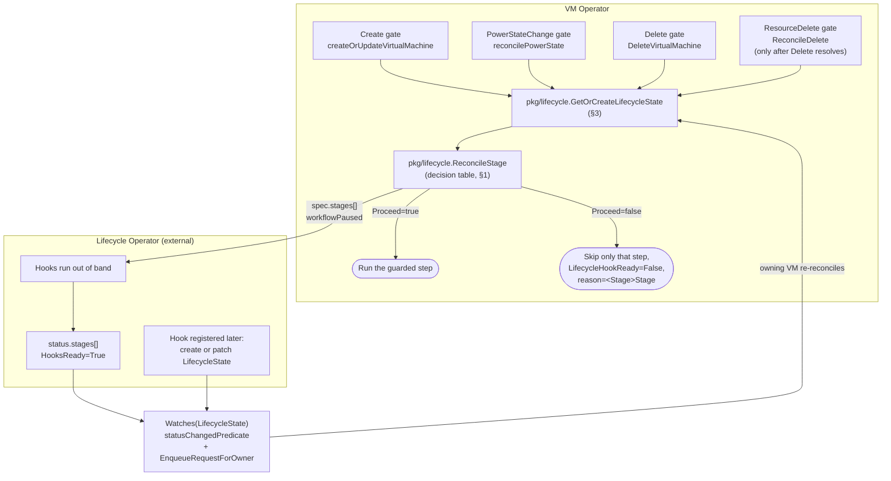

# Implementation Plan: Blocking Lifecycle Hooks

- **Spec**: [`spec.md`](./spec.md)
- **Model**: [`model.md`](./model.md)
- **Research**: [`research.md`](./research.md)
- **Epic**: vmop-3377
- **Date**: 2026-08-24
- **Status**: Draft

## Summary

Implements [`spec.md`](./spec.md): VM Operator pauses and resumes four `VirtualMachine` checkpoints — Create, PowerStateChange, Delete, ResourceDelete — by consuming the externally-owned `lifecycle.vcfa.vmware.com` CRDs, without reconciling any of them. Every checkpoint calls `pkg/lifecycle.GetOrCreateLifecycleState`, which creates the VM's owner-referenced `LifecycleState` if `LifecycleSubscribedStages` lists any hooked stage (§3), then the shared `pkg/lifecycle.ReconcileStage`, which pauses, holds, or resumes only that stage (§1, §2) and reports it through the `LifecycleHookReady` condition. A `LifecycleState` watch mapped by owner reference re-triggers the VM when its hooks resolve (§4).

## Technical context

- **Go version**: repo default (root `go.mod`).
- **API version touched**: `api/v1alpha6` — one additive condition type and four reasons; no field change, no version bump.
- **Modules touched**: root module (`api/`, `config/`, `controllers/`, `pkg/`) and a new `external/lifecycle` module (own `go.mod`, no third-party deps).
- **Feature flag**: `pkgcfg.FromContext(ctx).Features.LifecycleHooks`, set only from the `supports_vm_service_lifecycle_hooks` capability (spec G6). That capability depends on one the Lifecycle Framework enables when its package, including its CRDs, is installed, so the flag being set means the CRDs are present. A capability change restarts VM Operator (`pkgexit.Restart`).
- **Flag interactions**: none. The watch is informer-backed, not a `cource` channel, so it does not depend on `AsyncSignalEnabled`. The Create gate sits in `createOrUpdateVirtualMachine`, which both the blocking and the async (`AsyncSignalEnabled && AsyncCreateEnabled`) create paths call.

## Constitution check

| Rule | Status | Notes |
|---|---|---|
| API compatibility | OK | One new condition type and its reasons only. |
| Controllers are thin | OK | Gate logic in `pkg/lifecycle`; the controller and provider only call it. |
| No controller calls vSphere directly | OK | Create, PowerStateChange and Delete gates live in `pkg/providers/vsphere`; ResourceDelete gates a Kubernetes action (finalizer removal). |
| Non-`vmoperator.vmware.com` controllers outside `controllers/` | OK | No new controller; `LifecycleState` is read and patched, never reconciled. |
| External APIs under `external/` | OK | New `external/lifecycle` module, like `external/byok`. |
| Mappers use a field index | OK | `EnqueueRequestForOwner` resolves the VM from `ownerReferences`; no `List`, no index. |
| RBAC markers | OK | §6. |
| E2E ships with the behavior | OK | All four stages are cluster-observable; see "E2E". |
| Feature flag rollout documented | OK | Capability-gated; see "Rollout / migration". |

No constitutional rule is bent. "Complexity tracking" lists deviations from repository defaults.

## Project structure

### New files

```
external/lifecycle/                  # new module, vendored types only
  go.mod
  api/v1alpha1/
    doc.go
    groupversion_info.go
    lifecyclestate_types.go          # Get/Create/Patch target
    lifecyclesubscribedstages_types.go  # cached Get only
    lifecyclehook_types.go           # envtest fixtures only
    naming.go                        # LifecycleStateName,
                                     # SubscribedStagesName, vendored
    zz_generated.deepcopy.go

pkg/lifecycle/
  stage.go                           # ReconcileStage,
                                     # GetOrCreateLifecycleState,
                                     # AbandonStage,
                                     # MarkUnknown,
                                     # ReleaseLifecycleState,
                                     # ErrHooksBlocked,
                                     # statusChangedPredicate
  stage_test.go

config/crd/external-crds/            # make generate-external-manifests;
                                     # envtest only
  lifecycle.vcfa.vmware.com_lifecyclestates.yaml
  lifecycle.vcfa.vmware.com_lifecyclesubscribedstages.yaml
  lifecycle.vcfa.vmware.com_lifecyclehooks.yaml

config/lifecycle/
  vmoperator-stages.yaml             # LifecycleStages instance; shipped in
                                     # the Lifecycle Operator's package

test/builder/fakelifecycle/          # test-only fake Lifecycle Operator

test/e2e/vmservice/vmservice/virtualmachine/
  vm_lifecycle_hooks.go
```

### Modified files

```
Makefile                             # + external/lifecycle paths in
                                     #   generate-go and
                                     #   generate-external-manifests
config/crd/external-crds/README.md   # + the lifecycle CRDs
pkg/manager/manager.go               # + lifecyclev1.AddToScheme
pkg/config/config.go                 # + Features.LifecycleHooks
pkg/config/capabilities/capabilities.go
                                     # + CapabilityKeyLifecycleHooks,
                                     #   + case in
                                     #   updateCapabilitiesFeaturesFromCRD
api/v1alpha6/condition_consts.go     # + LifecycleHookReady and its
                                     #   four stage reasons
controllers/virtualmachine/virtualmachine/virtualmachine_controller.go
                                     # RBAC, LifecycleState watch,
                                     # APIReader field, ResourceDelete
                                     # gate, Delete event suppression
pkg/providers/vsphere/vmprovider_vm.go
                                     # Create, Delete and
                                     # PowerStateChange gates
pkg/util/vsphere/vm/power_state.go   # IsRestartDue split out of
                                     # RestartAndWait
test/builder/fake.go                 # + LifecycleState in KnownObjectTypes
```

Envtest needs no extra wiring: `test/builder/test_suite.go` loads all of `config/crd/external-crds`.

## API / CRD strategy

- **Additive**: one condition type in `api/v1alpha6`, `VirtualMachineConditionLifecycleHookReady`, with reasons `CreateStage`, `PowerStateChangeStage`, `DeleteStage`, `ResourceDeleteStage`. Conditions are not versioned fields, so no conversion work.
- **Vendored schema**: `external/lifecycle` mirrors the Lifecycle Operator's published API unchanged.
- **Generation** (outputs checked in): `make generate-go` and `make generate-external-manifests` for `LifecycleState`, `LifecycleSubscribedStages` and `LifecycleHook`.
- **CRD install**: none. The Lifecycle Framework installs its CRDs and only then enables the capability `supports_vm_service_lifecycle_hooks` depends on. The watch and cached `Get`s are registered only with `Features.LifecycleHooks` set, so they never start against a missing CRD.

## Controller / webhook impact

### 1. `pkg/lifecycle.ReconcileStage`

`ReconcileStage(ctx, k8sClient, vm, state, stageName) (Result, error)`

- **Leaf package**: called from both `controllers/virtualmachine/virtualmachine` and `pkg/providers/vsphere`, which do not import each other.
- **`state`**: the VM's `LifecycleState` from `GetOrCreateLifecycleState` (§3), or `nil` meaning no hook. `ReconcileStage` never fetches it, so the call site works on one in-memory copy across its calls.
- **`vm`**: only `vm.Status.Conditions` is mutated, via `conditions.Set`; the caller's patch persists it. `LifecycleHookReady` gets `reason=<stageName>Stage` and the status and message from model.md "New `VirtualMachine` API surface". It is not written when the stage has no hook.
- **Writes** patch `state` in place with `MergeFromWithOptimisticLock` against `state.DeepCopy()`, so `state` holds the new `resourceVersion` afterwards. A `409` is returned as a plain error and retried by the caller's requeue. A stale copy can delay a stage but never let it run early (model.md "Stale copies").
- **Capability off**: returns `Proceed=true`; no `LifecycleState` access. A `LifecycleHookReady` left from before is not touched.
- **Evaluation failure**: when `GetOrCreateLifecycleState` or a pause/release write fails at a checkpoint with anything other than a `409`, the call site sets `LifecycleHookReady` `Unknown`, `reason=<stageName>Stage`, message `Could not evaluate <stageName> hooks: <error>` (`lifecycle.MarkUnknown`), and returns the error, so the action stays held and is retried. A `409` writes no condition. The reconcile-start get-or-create (§2) has no stage and writes no condition.

| `LifecycleState` | Stage's `spec.stages[]` entry | `workflowPaused` | Stage's `status.stages[]` entry | Action | `Proceed` |
|---|---|---|---|---|---|
| `nil` | — | — | — | no condition write | `true` |
| found | absent | — | — | no condition write | `true` |
| found | present | `false` | present | **previous hold still being cleared**: do not pause; condition `False`, waiting | `false` |
| found | present | `false` | absent | pause: patch `(true, false)`; condition `False`, waiting | `false` |
| found | present | `true` | absent, or `HooksReady` not `True` | condition `False`, waiting or hook-failed by `HooksReady`'s reason | `false` |
| found | present | `true` | `HooksReady=True` | release: patch `(false, true)` (ResourceDelete: same write also removes `lifecycleStateFinalizer`); condition `True`, or `False` with a hook-failed message on `HookFailed` | `true` |

- **Switches** follow the Lifecycle Operator's transition table: pause → `(true, false)`, release → `(false, true)`; admission rejects anything else.
- **No stage branching in the decision**: pause, wait and release are the same for every stage. Reaching a checkpoint after a release is a new hold, including a retry of a failed create, delete or finalizer patch. The one stage-specific step is ResourceDelete's finalizer removal in the release write, for namespace-deletion protection.
- **Abandon**: a paused stage whose action is no longer needed is released, `(false, true)`, without running the action and whatever `HooksReady` says (`AbandonStage`, §3). The Lifecycle Operator's contract allows this and requires it instead of leaving the stage paused.
- **Waiting** (previous hold still being cleared, paused-not-ready) relies on the `LifecycleState` status watch; there is no timed requeue (model.md "Wakeups").
- **ResourceDelete releases and removes the finalizer in one write**, because a separate release patch would conflict with the Lifecycle Operator's status-entry removal (model.md "Releasing at `ResourceDelete`").
- VM Operator never adds or repairs `spec.stages[]` entries. Hooks registered later are the Lifecycle Operator's: it patches the stage into an existing `LifecycleState`, or creates the object.

### 2. Call sites

| Stage | Where | When blocked |
|---|---|---|
| Create | `createOrUpdateVirtualMachine`, after `getVM` returns `foundVM == nil`, before `ctxop.MarkCreate` | return `lifecycle.ErrHooksBlocked` |
| PowerStateChange | `reconcilePowerState`, inside `if setPowerState` before `SetPowerState`, and before `RestartAndWait` when a restart is due | return `nil` — skip only the power op |
| Delete | `DeleteVirtualMachine`, before `virtualmachine.DeleteVirtualMachine` | return `lifecycle.ErrHooksBlocked` |
| ResourceDelete | `ReconcileDelete`, before `controllerutil.RemoveFinalizer` | return `nil` — VM finalizer kept |

- **`state`**: every call site gets it from `GetOrCreateLifecycleState`. The controller and provider each fetch their own copy from the cache, so a write in `ReconcileDelete` before the Delete checkpoint (adoption, abandon) makes the provider's pause fail with a `409` once; the next pass completes it. Never early, one extra reconcile.
- **`ErrHooksBlocked`** is `pkgerr.NoRequeueNoErr("waiting for lifecycle hooks")`, matched with `errors.Is`.
- **Create keys off `getVM`, not `Status.UniqueID`**: snapshot revert wipes `Status` for a VM that still exists, and `getVM` still finds it via `Spec.InstanceUUID`. Placing the gate before `MarkCreate` keeps the controller from emitting `CreateFailure` (its catch-all case drops `NoRequeueNoErr`).
- **PowerStateChange returns `nil`, not `ErrHooksBlocked`**: `updateVirtualMachine` stops at a `NoRequeueError` from the power step, which would skip snapshot create (G2).
- **Restart**: `RestartAndWait`'s due check (`spec.nextRestartTime` newer than the last restart recorded in ExtraConfig, and not in the future) is split out as `vmutil.IsRestartDue`, so the gate runs only when a restart will happen.
- **Delete events**: `ReconcileDelete` sets a local `hooksBlocked` flag when the provider returns `ErrHooksBlocked` or the ResourceDelete gate blocks, and its deferred `EmitEvent(ctx.VM, "Delete", ...)` emits nothing while it is set. Other delete errors still emit `DeleteFailure`; each VM gets one `DeleteSuccess`. Not `filterNoRequeueErr`: it would turn existing `DeleteFailure` warnings into `DeleteSuccess`.
- **ResourceDelete proceed**: call `ReleaseLifecycleState` with the same `state`, then remove the VM finalizers. It is also called with the capability off (§3).
- **Adoption without a checkpoint**: `ReconcileNormal` and `ReconcileDelete` also call `GetOrCreateLifecycleState` once, after their pause-annotation early returns, so a `LifecycleState` the Lifecycle Operator creates gets VM Operator's finalizer on the reconcile its watch triggers, even when no checkpoint is reached.
- **Abandon call sites**:
  - `reconcilePowerState`: one `defer`, registered after the `isVMPaused`/`HasVMRunningTask` returns, calls `AbandonStage(PowerStateChange)` unless a local `powerChangeWanted` is set, merging its error into `retErr`. `powerChangeWanted` is set where `setPowerState` is true, where a restart is due, and at the `CheckAnnotationPowerOn` skip (power-on still wanted). Every later return, including the `On`/`On` ones and any added later, is covered; earlier returns ("cannot decide now") keep the hold. The gates stay direct `ReconcileStage` calls at `if setPowerState` and before `RestartAndWait`.
  - `ReconcileDelete`, before the Delete checkpoint: abandon Create and PowerStateChange.
  - ResourceDelete's final write (the release, or `ReleaseLifecycleState` when ResourceDelete has no hook) also releases any other paused stage, e.g. Delete when the vSphere VM disappeared out of band.
- **Power reversal** (a different power change requested while one is held): the hold is reused, since the State does not record its direction. Accepted limitation.
- **Ordering**: `ReconcileDelete` is straight-line, so ResourceDelete is never evaluated before Delete resolves.
- **No vSphere VM on delete**: `DeleteVirtualMachine` already returns `nil` when `getVM` finds nothing, before the gate. The Delete stage therefore passes; a stage left paused by an earlier checkpoint (such as Create) was already abandoned at the start of `ReconcileDelete`. `ResourceDelete` is still evaluated, and releasing VM Operator's finalizer lets GC remove the `LifecycleState`.
- **`SkipDeletePlatformResourceKey`**: the vSphere VM is only unregistered, so Delete is not evaluated; ResourceDelete still is.
- **Retries**: a retried vSphere create, vSphere delete, power operation or VM finalizer patch after a release pauses again (no stage branching, §1); hooks must be idempotent.

### 3. Helpers

**`GetOrCreateLifecycleState(ctx, k8sClient, vm) (*lifecyclev1.LifecycleState, error)`** — called at every checkpoint and once per `ReconcileNormal`/`ReconcileDelete` (§2):

1. Capability off → `nil`.
2. Cached `Get` of `LifecycleStateName("VirtualMachine", vm.UID)` in the VM's namespace, the name the Lifecycle Operator also uses.
   - Found: verify the binding — labels, and the single controller owner reference matching the VM's group, kind, name and UID; terminating only if it carries `lifecycleStateFinalizer`. A mismatch returns a plain error (retried with backoff); its stages are never read.
   - Found without `lifecycleStateFinalizer` and not terminating (adoption): add it under the optimistic lock, other finalizers kept; a `409` is returned and retried.
   - Return it.
3. `NotFound`: cached `Get` of `SubscribedStagesName("vmoperator.vmware.com", "VirtualMachine")` in the namespace; `NotFound` → `nil` (G5).
4. `Create` the `LifecycleState` with `controllerutil.SetControllerReference(vm, state, scheme, controllerutil.WithBlockOwnerDeletion(false))`, the `target-group`/`target-kind` labels, `lifecycleStateFinalizer`, and every listed stage at `(false, false)`. Return the created object.
5. `AlreadyExists` (another creator won, or the cache is behind) → `pkgerr.RequeueError{After: time.Second}`, so the next pass re-reads it; never `nil`.
6. Rejected because the namespace is terminating (`apierrors.HasStatusCause(err, corev1.NamespaceTerminatingCause)`) → `nil`, the accepted race in model.md "Namespace-deletion protection".

- Never `List`s or watches `LifecycleHook`.

**`AbandonStage(ctx, k8sClient, vm, state, stageName)`**:

- Stage paused → patch `(false, true)` under the optimistic lock and set `LifecycleHookReady` `True` with `reason=<stageName>Stage`; otherwise no-op.
- `nil` or capability off → no-op.

**`ReleaseLifecycleState(ctx, k8sClient, apiReader, vm, state)`**:

- Removes `lifecycleStateFinalizer`, and releases any other paused stage in the same write, under the optimistic lock; no-op if already absent (ResourceDelete's release write removes it when that stage has a hook).
- Capability off: one `Get` through `apiReader` (no informer is started); `NotFound` or `meta.IsNoMatchError` → no-op. Without this, a `LifecycleState` created while the capability was on would block VM and namespace deletion.
- Never deletes the `LifecycleState`; GC or the namespace controller does.

**Constant**: `lifecycleStateFinalizer` = `lifecycle.vcfa.vmware.com/vm-operator-state`.

### 4. Watch

- `Watches(&lifecyclev1.LifecycleState{}, handler.EnqueueRequestForOwner(mgr.GetScheme(), mgr.GetRESTMapper(), &vmopv1.VirtualMachine{}), builder.WithPredicates(statusChangedPredicate{}))`, gated on `Features.LifecycleHooks` — the same shape as the `PolicyEvaluation` watch.
- `statusChangedPredicate`: `Create` → true only without `lifecycleStateFinalizer` (Lifecycle-Operator-created, for adoption); `Generic` → false; `Delete` → true; `Update` → true only when `status` differs (`apiequality.Semantic.DeepEqual`). This drops VM Operator's own creates and `spec` writes.
- `LifecycleSubscribedStages` is never watched — one object covers every VM in the namespace. Its informer only backs the cached `Get`.

### 5. Webhooks

None.

### 6. RBAC

- `lifecyclestates`: get, list, watch, create, patch, delete. `delete` is never called; the `OwnerReferencesPermissionEnforcement` admission plugin requires it to set an owner reference. No `lifecyclestates/status` verbs. No `update` on `virtualmachines/finalizers`, since `blockOwnerDeletion` is always `false`.
- `lifecyclesubscribedstages`: get, list, watch.
- None for `lifecyclehooks` or `lifecyclestages`.

## Reconcile flow



## Test strategy

Per `testing-standards.md`: one `_test.go` and one `_suite_test.go` per package, external `_test` package, labels on the top-level `Describe`.

### Unit (`testlabels.Controller`)

`pkg/lifecycle/stage_test.go`, fake client with `lifecyclev1.AddToScheme`:

- **`GetOrCreateLifecycleState`**:
  - No `LifecycleState` and no `LifecycleSubscribedStages` at `lss-1b52874a51e98527` → `nil`, nothing created.
  - Hooks listed → object created with the finalizer, `controller: true`, `blockOwnerDeletion: false`, and every listed stage at `(false, false)`, and returned; a second call returns the cached object with no write.
  - Cache `NotFound` but `Create` returns `AlreadyExists` → `RequeueError`, never `nil`.
  - `Create` rejected with `NamespaceTerminatingCause` → `nil`.
  - Gets `virtualmachine-<vm.UID>`: matching binding → returned; wrong labels, owner kind/UID, or terminating without the finalizer → error and its stages never read. A VM recreated with the same name gets its own State.
  - Lifecycle-Operator-created State without the finalizer → finalizer added, other finalizers kept; already carrying it → no patch; concurrent writer → conflict.
- **`ReconcileStage`**, every table row:
  - `nil` or entry absent → proceed, no write, `LifecycleHookReady` not written and an existing one unchanged.
  - Pause → `(true, false)`, also when starting from `(false, true)`, for every stage.
  - Previous hold still being cleared → no patch, no requeue.
  - Paused and `HooksReady` absent or `False/HooksPending` → blocked, waiting message; `False/HookFailed` → blocked, hook-failed message.
  - Release → `(false, true)`, `state` carries the new `resourceVersion`; condition `True` on `AllHooksSucceeded`/`NoHooksRegistered`, `False` with the hook-failed message on `True/HookFailed`. Next reach of any stage re-pauses once the status entry is gone and waits while it is present.
  - Create then pause in one pass with no intermediate read.
  - ResourceDelete release also removes the finalizer and releases any other paused stage in the same write, other finalizers kept; an object without the finalizer releases normally.
  - A stale-copy or concurrently-modified pause/release → `409` returned, not retried internally, no condition written.
  - `GetOrCreateLifecycleState` or a pause/release failing with an API error or binding mismatch → error returned, `LifecycleHookReady` `Unknown` with the stage reason and error message, including at the first stage reached.
- **`ReleaseLifecycleState`**: removes only VM Operator's finalizer under the lock; absent or `nil` → no patch; a concurrent writer's finalizer → conflict, theirs kept. Capability off → one `APIReader` `Get` and the finalizer removed; `NotFound` or no-match → no-op.
- **Capability off**: the four stage call sites make zero `LifecycleState`/`LifecycleSubscribedStages` calls (call-counting fake); a leftover `LifecycleHookReady` is left unchanged.
- **`AbandonStage`**: paused, with `HooksReady` absent, `False` or `True` → `(false, true)`, condition `True`; not paused or `nil` → no patch.
- **`statusChangedPredicate`**: `Create` with the finalizer, `Generic` and spec-only `Update` filtered; `Create` without it, status `Update` and `Delete` pass.

`pkg/providers/vsphere/vmprovider_vm_test.go`:

- **Create**: no hook → creates, no condition; blocked → `ErrHooksBlocked`, no vSphere create, condition blocked; `foundVM != nil`, including a wiped `Status` after revert, never reaches the gate; a failed create after release pauses again.
- **Delete**: blocked → `ErrHooksBlocked`, `virtualmachine.DeleteVirtualMachine` not called; no entry → unchanged; a failed delete after release pauses again; no vSphere VM → returns `nil` before the gate.
- **PowerStateChange**: blocked power-on, power-off, suspend and due restart issue no power task while the rest of the update, including snapshot create, still runs; a restart that is not due does not pause; the two directions pause independently; a held power change cancelled by reverting `spec.powerState` is abandoned, and the next request pauses afresh.

`controllers/virtualmachine/virtualmachine/*_test.go`:

- **Adoption**: a Lifecycle-Operator-created State gets the finalizer on the next reconcile with no checkpoint reached.
- **Abandon on delete**: Create or PowerStateChange held when the VM is deleted → released before the Delete checkpoint, condition `True`.
- **ResourceDelete**: VM finalizer kept while blocked; evaluated only after Delete resolved; `ReleaseLifecycleState` called once, before `RemoveFinalizer`; a failed VM finalizer patch after release pauses `ResourceDelete` again.
- **Events**: none while a stage is blocked; one `DeleteSuccess` across the sequence; an unsupported-connection-state `NoRequeueError` still emits `DeleteFailure`.

### Integration (`testlabels.EnvTest`)

The Lifecycle Operator is stood in by test code (tier 1), or by `test/builder/fakelifecycle` (tier 2), which mirrors `LifecycleHook` create/delete into `LifecycleSubscribedStages` and into a new or existing `LifecycleState`'s `spec.stages[]`, and rejects non-canonical State names and switch transitions outside the Lifecycle Operator's table. Neither tier computes `HooksReady`; tests set it directly.

- **Watch** (tier 1): a `HooksReady` flip re-queues the owning VM; VM Operator's own `spec` write does not; the Lifecycle Operator creating a status entry after a pause does; removing a status entry after a release does.
- **Sequencing** (tier 1): hooks on all four stages; the VM never passes a stage before its `HooksReady` flip; ResourceDelete is not paused until Delete resolves; the `LifecycleState` is gone once both finalizers clear.
- **Initialization** (tier 1): `LifecycleSubscribedStages` lists `Create` and `Delete` → the object created on the VM's first reconcile already carries the `Delete` entry.
- **Hook registered later** (tier 2): VM created with no hooks and no condition; a new `Delete` hook makes `fakelifecycle` create the `LifecycleState`; VM Operator adds its finalizer without a VM change; deleting the VM blocks on Delete.

### E2E (mandatory, `e2e-sync-with-changes.md`)

New suite `test/e2e/vmservice/vmservice/virtualmachine/vm_lifecycle_hooks.go`, registered from `test/e2e/vmservice/vmservice_test.go`, with the real Lifecycle Operator installed.

- **Baseline**: Create; PowerStateChange in both directions, suspend, and restart; Delete then ResourceDelete, including with only one of them hooked; no hooks in the namespace → no `LifecycleHookReady`; capability disabled with hooks registered → no behavior change (SC-005).
- **Hook failure**: a failed hook → the action runs and `LifecycleHookReady` is `False` with the hook-failed message.
- **Hook registered later**: a resolved Create hook, then a new Delete hook; deleting the VM blocks on Delete.
- **Namespace deletion** (US3 scenario 5, SC-007): a Delete hook present at first reconcile; the namespace stays `Terminating` and the VM and `LifecycleState` remain, condition `False`, until the hook resolves; then both are deleted.
- **Single-VM delete** with the same hook, for contrast.
- **Abandoned holds**: a held power-off cancelled by reverting `spec.powerState`, and a held Create followed by VM delete; the stage's `status.stages[]` entry is removed and the condition is `True`.
- **Hook deleted while its stage is paused**: VM Operator's condition and finalizer follow whatever the Lifecycle Operator does with `HooksReady`.

## Rollout / migration

- **Capability gate**: new `CapabilityKeyLifecycleHooks` constant and `case` in `updateCapabilitiesFeaturesFromCRD`, the same wiring as `CapabilityKeyBringYourOwnKeyProvider`. The capability depends on the one the Lifecycle Framework enables at install.
- **No schema upgrade or backfill**: the feature is level-triggered; enabling the capability needs no migration.
- **Turning the capability off**: VM Operator restarts and every checkpoint becomes a no-op; a leftover `LifecycleHookReady` remains as last written. `LifecycleState` objects stay; `ReleaseLifecycleState` still removes VM Operator's finalizer when a VM is deleted. The Lifecycle Operator may keep running hooks VM Operator no longer waits on.
- **Partner comms**: announce through the usual capability-gated feature process once the Lifecycle framework team confirms the contract.
- **Release notes**: with the first PR that enables a stage gate, naming `LifecycleHookReady`, its reasons and the capability.

## Complexity tracking

| Deviation | Why needed | Simpler alternative rejected because |
|---|---|---|
| New leaf package `pkg/lifecycle` | Called from both the VM controller and the vSphere provider, which do not import each other | Either caller's package would force a controller ↔ provider import |
| Depends on Lifecycle-Operator-owned `LifecycleSubscribedStages` | Zero-hook VMs must cost nothing (G5) | Watching `LifecycleHook` locally duplicates the Lifecycle Operator's matching logic (`research.md` Candidate 1) |
| Get-or-create at every checkpoint | VM Operator and the Lifecycle Operator can each reach a VM first | A single create point misses VMs whose first reconcile passed before a hook existed |
| Optimistic-lock patches on `spec.stages[]` and `metadata.finalizers` | Both lists have two writers | A plain merge patch replaces the list and silently drops the other writer's entry |
| `statusChangedPredicate` on the watch | Only `status` changes and Lifecycle-Operator creates (adoption) carry information VM Operator lacks | No predicate re-reconciles the VM on its own creates and `spec` writes |
| Gate decided at each call site | PowerStateChange is only known inside `if setPowerState` or once a restart is due; ResourceDelete must wait for Delete | An upfront pass would duplicate that logic or pause stages that are not being reached |
