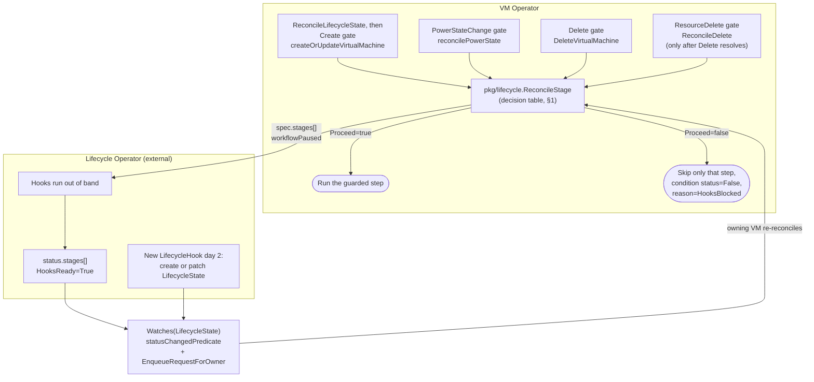

# Implementation Plan: Blocking Lifecycle Hooks

- **Spec**: [`spec.md`](./spec.md)
- **Model**: [`model.md`](./model.md)
- **Research**: [`research.md`](./research.md)
- **Epic**: vmop-3377
- **Date**: 2026-08-24
- **Status**: Draft

## Summary

Implements [`spec.md`](./spec.md): VM Operator pauses and resumes four `VirtualMachine` checkpoints — Create, PowerStateChange, Delete, ResourceDelete — by consuming the externally-owned `lifecycle.vcfa.vmware.com` CRDs, without reconciling any of them. Before a VM's first create, `pkg/lifecycle.ReconcileLifecycleState` creates the VM's owner-referenced `LifecycleState` if `LifecycleSubscribedStages` lists any hooked stage (§3); at each checkpoint, the shared `pkg/lifecycle.ReconcileStage` pauses, holds, or resumes only that stage (§1, §2) and reports it through that stage's own `VirtualMachine` condition. A `LifecycleState` watch mapped by owner reference re-triggers the VM when its hooks resolve (§4).

## Technical context

- **Go version**: repo default (root `go.mod`).
- **API version touched**: `api/v1alpha6` — four additive condition types; no field change, no version bump.
- **Modules touched**: root module (`api/`, `config/`, `controllers/`, `pkg/`) and a new `external/lifecycle` module (own `go.mod`, no third-party deps).
- **Feature flag**: `pkgcfg.FromContext(ctx).Features.LifecycleHooks`, set only from the `supports_vm_service_lifecycle_hooks` capability (spec G6). A capability change restarts VM Operator (`pkgexit.Restart`).
- **Flag interactions**: none. The watch is informer-backed, not a `cource` channel, so it does not depend on `AsyncSignalEnabled`. The Create gate sits in `createOrUpdateVirtualMachine`, which both the blocking and the async (`AsyncSignalEnabled && AsyncCreateEnabled`) create paths call.

## Constitution check

| Rule | Status | Notes |
|---|---|---|
| API compatibility | OK | Four new condition types only. |
| Controllers are thin | OK | Gate logic in `pkg/lifecycle`; the controller and provider only call it. |
| No controller calls vSphere directly | OK | Create, PowerStateChange and Delete gates live in `pkg/providers/vsphere`; ResourceDelete gates a Kubernetes action (finalizer removal). |
| Non-`vmoperator.vmware.com` controllers outside `controllers/` | OK | No new controller; `LifecycleState` is read and patched, never reconciled. |
| External APIs under `external/` | OK | New `external/lifecycle` module, like `external/byok`. |
| Mappers use a field index | OK | `EnqueueRequestForOwner` resolves the VM from `ownerReferences`; no `List`, no index. |
| RBAC markers | OK | §6. |
| E2E ships with the behavior | OK | All four stages are cluster-observable; see "E2E". |
| Feature flag rollout documented | OK | Capability-gated; see "Rollout / migration". |

No constitutional rule is bent. "Complexity tracking" lists deviations from repository defaults.

## Project structure

### New files

```
external/lifecycle/                  # new module, vendored types only
  go.mod
  api/v1alpha1/
    doc.go
    groupversion_info.go
    lifecyclestate_types.go          # Get/Create/Patch target
    lifecyclesubscribedstages_types.go  # cached List only
    lifecyclehook_types.go           # envtest fixtures only
    zz_generated.deepcopy.go

pkg/lifecycle/
  stage.go                           # ReconcileStage,
                                     # ReconcileLifecycleState,
                                     # GetLifecycleState,
                                     # ReleaseLifecycleState,
                                     # ErrHooksBlocked,
                                     # statusChangedPredicate
  stage_test.go

config/crd/external-crds/            # make generate-external-manifests
  lifecycle.vcfa.vmware.com_lifecyclestates.yaml
  lifecycle.vcfa.vmware.com_lifecyclesubscribedstages.yaml
  lifecycle.vcfa.vmware.com_lifecyclehooks.yaml    # envtest only

config/lifecycle/
  vmoperator-stages.yaml             # LifecycleStages instance; shipped in
                                     # the Lifecycle Operator's package

test/builder/fakelifecycle/          # test-only fake Lifecycle Operator

test/e2e/vmservice/vmservice/virtualmachine/
  vm_lifecycle_hooks.go
```

### Modified files

```
Makefile                             # + external/lifecycle paths in
                                     #   generate-go and
                                     #   generate-external-manifests
config/crd/crd.go                    # + //go:embed of the two lifecycle
                                     #   CRDs by exact file name, not a
                                     #   lifecycle.vcfa.vmware.com_* glob
pkg/crd/crd.go                       # + case "LifecycleState",
                                     #   "LifecycleSubscribedStages":
                                     #   create if absent, never patch
                                     #   or delete
config/crd/external-crds/README.md   # + the lifecycle CRDs
pkg/manager/manager.go               # + lifecyclev1.AddToScheme
pkg/config/config.go                 # + Features.LifecycleHooks
pkg/config/capabilities/capabilities.go
                                     # + CapabilityKeyLifecycleHooks,
                                     #   + case in
                                     #   updateCapabilitiesFeaturesFromCRD
api/v1alpha6/virtualmachine_types.go     # + four HooksReady condition types
controllers/virtualmachine/virtualmachine/virtualmachine_controller.go
                                     # RBAC, LifecycleState watch,
                                     # APIReader field, ResourceDelete
                                     # gate, Delete event suppression
pkg/providers/vsphere/vmprovider_vm.go
                                     # Create, Delete and
                                     # PowerStateChange gates
test/builder/fake.go                 # + LifecycleState in KnownObjectTypes
```

Envtest needs no extra wiring: `test/builder/test_suite.go` loads all of `config/crd/external-crds`.

## API / CRD strategy

- **Additive**: four condition types in `api/v1alpha6` (`VirtualMachineConditionCreateHooksReady`, `...PowerStateChangeHooksReady`, `...DeleteHooksReady`, `...ResourceDeleteHooksReady`). Conditions are not versioned fields, so no conversion work.
- **Vendored schema**: `external/lifecycle` mirrors the Lifecycle Operator's published API unchanged.
- **Generation** (outputs checked in): `make generate-go` and `make generate-external-manifests` for `LifecycleState`, `LifecycleSubscribedStages` and `LifecycleHook`.
- **CRD install** — `pkgcrd.Install`, called from `main.go`'s `initCRDs` before controllers register:
  - `LifecycleState` and `LifecycleSubscribedStages` are created at startup **if absent**, so the watch and cached `List` start whichever operator is installed first. An existing CRD is left untouched, so the Lifecycle Operator's schema always wins.
  - Created regardless of the capability and **never deleted**: gating on the flag would let `CRDCleanupEnabled=true` delete the Lifecycle Operator's CRD and every instance with it.
  - `LifecycleHook` and `LifecycleStages` are never installed by VM Operator.

## Controller / webhook impact

### 1. `pkg/lifecycle.ReconcileStage`

`ReconcileStage(ctx, k8sClient, vm, state, stageName, conditionType) (Result, error)`

- **Leaf package**: called from both `controllers/virtualmachine/virtualmachine` and `pkg/providers/vsphere`, which do not import each other.
- **`state`**: the VM's `LifecycleState`, or `nil` meaning no hook. `ReconcileStage` never fetches it: the Create site passes `ReconcileLifecycleState`'s result, the other three pass `GetLifecycleState`'s (§3).
- **`vm`**: only `vm.Status.Conditions` is mutated; the caller's patch persists it. The `False` reason is always `HooksBlocked`, whatever made `HooksReady` non-`True`; the message names the stage.
- **Writes** patch `state` in place with `MergeFromWithOptimisticLock` against `state.DeepCopy()`, so `state` holds the new `resourceVersion` afterwards. A `409` is returned as a plain error and retried by the caller's requeue. A stale copy can delay a stage but never let it run early (model.md "Stale copies").
- **Capability off**: returns `Proceed=true` and removes this stage's condition if one was left over; no `LifecycleState` access.

| `LifecycleState` | Stage's `spec.stages[]` entry | `workflowPaused` | Stage's `status.stages[]` entry | Action | `Proceed` |
|---|---|---|---|---|---|
| `nil` | — | — | — | condition `True` | `true` |
| found | absent | — | — | condition `True` | `true` |
| found | present | `false` | present | **reset pending**: do not pause; condition `False`/`HooksBlocked`; wait for the watch | `false` |
| found | present | `false` | absent | pause: patch `workflowPaused=true`, `workflowResumed=false`; condition `False`/`HooksBlocked` | `false` |
| found | present | `true` | absent, or `HooksReady` not `True` | condition stays `False`/`HooksBlocked` | `false` |
| found | present | `true` | `HooksReady=True` | resume: patch `workflowPaused=false`, `workflowResumed=false` (ResourceDelete: same write also removes `lifecycleStateFinalizer`); condition `True` | `true` |

- **Pause** always writes `workflowResumed=false`: a user resume `(false, true)` may still be in place, and `(true, true)` is rejected by the Lifecycle Operator's webhook.
- **Resume** `(false, false)` cues the Lifecycle Operator to remove the status entry; the next reach then starts a fresh pass. Every stage is `Reentrant`; the gate never branches on stage type.
- **Waiting** (reset pending, paused-not-ready) relies on the `LifecycleState` status watch; there is no timed requeue (model.md "Wakeups").
- **ResourceDelete resumes and releases in one write**, because a separate release patch would conflict with the Lifecycle Operator's status-entry removal (model.md "Releasing at `ResourceDelete`").
- A condition is written only when its checkpoint is reached; consumers treat absent as `True`.
- VM Operator never adds or repairs `spec.stages[]` entries. Day-2 hooks are the Lifecycle Operator's: it patches the stage into an existing `LifecycleState`, or creates the object.

### 2. Call sites

| Stage | Where | `state` from | When blocked |
|---|---|---|---|
| Create | `createOrUpdateVirtualMachine`, after `getVM` returns `foundVM == nil`, before `ctxop.MarkCreate` | `ReconcileLifecycleState` | return `lifecycle.ErrHooksBlocked` |
| PowerStateChange | `reconcilePowerState`, inside `if setPowerState`, before `SetPowerState` | `GetLifecycleState` | return `nil` — skip only the power op |
| Delete | `DeleteVirtualMachine`, before `virtualmachine.DeleteVirtualMachine` | `GetLifecycleState` | return `lifecycle.ErrHooksBlocked` |
| ResourceDelete | `ReconcileDelete`, before `controllerutil.RemoveFinalizer` | `GetLifecycleState` | return `nil` — VM finalizer kept |

- **`ErrHooksBlocked`** is `pkgerr.NoRequeueNoErr("waiting for lifecycle hooks")`, matched with `errors.Is`.
- **Create keys off `getVM`, not `Status.UniqueID`**: snapshot revert wipes `Status` for a VM that still exists, and `getVM` still finds it via `Spec.InstanceUUID`. Placing the gate before `MarkCreate` keeps the controller from emitting `CreateFailure` (its catch-all case drops `NoRequeueNoErr`).
- **PowerStateChange returns `nil`, not `ErrHooksBlocked`**: `updateVirtualMachine` stops at a `NoRequeueError` from the power step, which would skip snapshot create (G2).
- **Delete events**: `ReconcileDelete` sets a local `hooksBlocked` flag when the provider returns `ErrHooksBlocked` or the ResourceDelete gate blocks, and its deferred `EmitEvent(ctx.VM, "Delete", ...)` emits nothing while it is set. Other delete errors still emit `DeleteFailure`; each VM gets one `DeleteSuccess`. Not `filterNoRequeueErr`: it would turn existing `DeleteFailure` warnings into `DeleteSuccess`.
- **ResourceDelete proceed**: call `ReleaseLifecycleState` with the same `state`, then remove the VM finalizers. It is also called with the capability off (§3).
- **Ordering**: `ReconcileDelete` is straight-line, so ResourceDelete is never evaluated before Delete resolves.
- **No vSphere VM on delete**: `DeleteVirtualMachine` already returns `nil` when `getVM` finds nothing, before the gate. The Delete stage therefore passes, and a stage left paused by an earlier checkpoint (such as Create) is simply dropped. `ResourceDelete` is still evaluated, and releasing VM Operator's finalizer lets GC remove the `LifecycleState`.
- **`SkipDeletePlatformResourceKey`**: the vSphere VM is only unregistered, so Delete is not evaluated; ResourceDelete still is.
- **Retries**: a retried vSphere delete re-pauses Delete, and a failed VM finalizer patch after ResourceDelete resumed re-pauses ResourceDelete; hooks must be idempotent.

### 3. Helpers

**`ReconcileLifecycleState(ctx, k8sClient, vm) (*lifecyclev1.LifecycleState, error)`** — runs on every pass that reaches the Create checkpoint:

1. Capability off → `nil`.
2. `GetLifecycleState` finds the object (below) → return it; a stale object → its error.
3. Cached `List` of `LifecycleSubscribedStages` in the namespace, selected by `lifecycle.vcfa.vmware.com/target-group=vmoperator.vmware.com` and `lifecycle.vcfa.vmware.com/target-kind=VirtualMachine`. Union the `spec.stages[]` of all matches; no match → `nil` (G5).
4. `Create` the `LifecycleState`, named `vm-<vm.Name>`, with `controllerutil.SetControllerReference(vm, state, scheme, controllerutil.WithBlockOwnerDeletion(false))`, `lifecycleStateFinalizer`, `spec.target`, and every listed stage at `(false, false)`. Return the created object.
5. `AlreadyExists` after a cached `NotFound` (cache behind) → `pkgerr.RequeueError{After: time.Second}`, never `nil`. The controller's catch-all case emits one `ReconcileNormalFailure` warning for it.

- Never `List`s or watches `LifecycleHook`.

**`GetLifecycleState(ctx, k8sClient, vm)`** — used by step 2 and by the other three call sites:

- A cached `Get` of `vm-<vm.Name>` in the VM's namespace. The Lifecycle Operator uses the same name for a day-2 object (model.md "`LifecycleState`"). VM names are DNS labels of at most 63 characters, so the prefixed name always fits.
- `NotFound` → `nil`.
- `spec.target.uid` ≠ `vm.UID` → **stale**: a leftover of an earlier VM with the same name, awaiting GC. Return a plain error, so the VM retries with backoff until GC removes it; its stages are never read.
- Capability off → `nil`.

**`ReleaseLifecycleState(ctx, k8sClient, apiReader, vm, state)`**:

- Removes only `lifecycleStateFinalizer`, under the optimistic lock; no-op if already absent (ResourceDelete's resume write removes it when that stage has a hook).
- Capability off: one `Get` through `apiReader` (no informer is started); `NotFound` or `meta.IsNoMatchError` → no-op. Without this, a `LifecycleState` created while the capability was on would block VM and namespace deletion.
- Never deletes the `LifecycleState`; GC or the namespace controller does.

**Constant**: `lifecycleStateFinalizer` = `lifecycle.vcfa.vmware.com/vm-operator-state`.

### 4. Watch

- `Watches(&lifecyclev1.LifecycleState{}, handler.EnqueueRequestForOwner(mgr.GetScheme(), mgr.GetRESTMapper(), &vmopv1.VirtualMachine{}), builder.WithPredicates(statusChangedPredicate{}))`, gated on `Features.LifecycleHooks` — the same shape as the `PolicyEvaluation` watch.
- `statusChangedPredicate`: `Create` and `Generic` → false; `Delete` → true; `Update` → true only when `status` differs (`apiequality.Semantic.DeepEqual`). This drops VM Operator's own creates and `spec` writes.
- `LifecycleSubscribedStages` is never watched — one object covers every VM in the namespace. Its informer only backs the cached `List`.

### 5. Webhooks

None.

### 6. RBAC

- `lifecyclestates`: get, list, watch, create, patch. No `lifecyclestates/status` verbs. No `update` on `virtualmachines/finalizers`, since `blockOwnerDeletion` is always `false`.
- `lifecyclesubscribedstages`: get, list, watch.
- None for `lifecyclehooks` or `lifecyclestages`.

## Reconcile flow



## Test strategy

Per `testing-standards.md`: one `_test.go` and one `_suite_test.go` per package, external `_test` package, labels on the top-level `Describe`.

### Unit (`testlabels.Controller`)

`pkg/lifecycle/stage_test.go`, fake client with `lifecyclev1.AddToScheme`:

- **`ReconcileLifecycleState`**:
  - No `LifecycleSubscribedStages`, or only ones for another `(group, kind)` → `nil`, nothing created.
  - Hooks present → object created with the finalizer, `controller: true`, `blockOwnerDeletion: false`, and every listed stage at `(false, false)`, and returned; a second call returns the cached object with no write.
  - Cache `NotFound` but `Create` returns `AlreadyExists` → `RequeueError`, never `nil`.
  - `GetLifecycleState` gets `vm-<vm.Name>`: `NotFound` → `nil`; matching `spec.target.uid` → returned; another UID (stale) → error and its stages never read, from both `GetLifecycleState` and `ReconcileLifecycleState`.
- **`ReconcileStage`**, every table row:
  - `nil` → proceed, condition `True`; entry absent → proceed, no write.
  - Pause → `(true, false)`, also when starting from `(false, true)`.
  - Reset pending → no patch, no requeue.
  - Paused and `HooksReady` absent, `False`, or any non-`True` reason → blocked.
  - Resume → `(false, false)`, condition `True`, `state` carries the new `resourceVersion`; next reach re-pauses once the status entry is gone and waits while it is present.
  - Create then pause in one pass with no intermediate read.
  - ResourceDelete resume also removes the finalizer in the same write, other finalizers kept; a day-2 object without the finalizer resumes normally.
  - A stale-copy or concurrently-modified pause/resume → `409` returned, not retried internally.
- **`ReleaseLifecycleState`**: removes only VM Operator's finalizer under the lock; absent or `nil` → no patch; a concurrent writer's finalizer → conflict, theirs kept. Capability off → one `APIReader` `Get` and the finalizer removed; `NotFound` or no-match → no-op.
- **Capability off**: the four stage call sites make zero `LifecycleState`/`LifecycleSubscribedStages` calls (call-counting fake); a leftover `False` condition is removed at its checkpoint.
- **`statusChangedPredicate`**: `Create`/`Generic` and spec-only `Update` filtered; status `Update` and `Delete` pass.

`pkg/providers/vsphere/vmprovider_vm_test.go`:

- **Create**: no hook → creates; blocked → `ErrHooksBlocked`, no vSphere create, condition blocked; `foundVM != nil`, including a wiped `Status` after revert, never reaches the gate.
- **Delete**: blocked → `ErrHooksBlocked`, `virtualmachine.DeleteVirtualMachine` not called; resumed or no entry → unchanged; no vSphere VM → returns `nil` before the gate.
- **PowerStateChange**: blocked power-on and power-off issue no power task while the rest of the update, including snapshot create, still runs; the two directions pause independently.

`controllers/virtualmachine/virtualmachine/*_test.go`:

- **ResourceDelete**: VM finalizer kept while blocked; evaluated only after Delete resolved; `ReleaseLifecycleState` called once, before `RemoveFinalizer`; a failed VM finalizer patch after resume pauses `ResourceDelete` again (at-least-once).
- **Events**: none while a stage is blocked; one `DeleteSuccess` across the sequence; an unsupported-connection-state `NoRequeueError` still emits `DeleteFailure`.

### Integration (`testlabels.EnvTest`)

The Lifecycle Operator is stood in by test code (tier 1), or by `test/builder/fakelifecycle` (tier 2), which mirrors `LifecycleHook` create/delete into `LifecycleSubscribedStages` and into a new or existing `LifecycleState`'s `spec.stages[]`. Neither tier computes `HooksReady`; tests set it directly.

- **Watch** (tier 1): a `HooksReady` flip re-queues the owning VM; VM Operator's own `spec` write does not; the Lifecycle Operator creating a status entry after a pause does; removing a status entry after a resume does.
- **Sequencing** (tier 1): hooks on all four stages; the VM never passes a stage before its `HooksReady` flip; ResourceDelete is not paused until Delete resolves; the `LifecycleState` is gone once both finalizers clear.
- **Initialization** (tier 1): `LifecycleSubscribedStages` lists `Create` and `Delete` → the object created at the Create checkpoint already carries the `Delete` entry.
- **Day 2** (tier 2): VM created with no hooks; a new `Delete` hook makes `fakelifecycle` create the `LifecycleState`; deleting the VM blocks on Delete.

### E2E (mandatory, `e2e-sync-with-changes.md`)

New suite `test/e2e/vmservice/vmservice/virtualmachine/vm_lifecycle_hooks.go`, registered from `test/e2e/vmservice/vmservice_test.go`, with the real Lifecycle Operator installed.

- **Baseline**: Create; PowerStateChange in both directions; Delete then ResourceDelete, including with only one of them hooked; capability disabled with hooks registered → no behavior change (SC-005).
- **Day 2**: a resolved Create hook, then a new Delete hook; deleting the VM blocks on Delete.
- **Namespace deletion** (US3 scenario 5, SC-007): a Delete hook present at first reconcile; the namespace stays `Terminating` and the VM and `LifecycleState` remain, condition `False`, until the hook resolves; then both are deleted.
- **Single-VM delete** with the same hook, for contrast.
- **Hook deleted while its stage is paused**: VM Operator's condition and finalizer follow whatever the Lifecycle Operator does with `HooksReady`.

## Rollout / migration

- **Capability gate**: new `CapabilityKeyLifecycleHooks` constant and `case` in `updateCapabilitiesFeaturesFromCRD`, the same wiring as `CapabilityKeyBringYourOwnKeyProvider`.
- **No schema upgrade or backfill**: the feature is level-triggered; enabling the capability needs no migration.
- **Turning the capability off**: VM Operator restarts and every checkpoint becomes a no-op; leftover `False` conditions are removed when their checkpoint is reached. `LifecycleState` objects and the CRDs stay; `ReleaseLifecycleState` still removes VM Operator's finalizer when a VM is deleted. The Lifecycle Operator may keep running hooks VM Operator no longer waits on.
- **Partner comms**: announce through the usual capability-gated feature process once the confirmations below are in.
- **Release notes**: with the first PR that enables a stage gate, naming the four conditions and the capability.

## Complexity tracking

| Deviation | Why needed | Simpler alternative rejected because |
|---|---|---|
| New leaf package `pkg/lifecycle` | Called from both the VM controller and the vSphere provider, which do not import each other | Either caller's package would force a controller ↔ provider import |
| Depends on Lifecycle-Operator-owned `LifecycleSubscribedStages` | Zero-hook VMs must cost nothing (G5) | Watching `LifecycleHook` locally duplicates the Lifecycle Operator's matching logic (`research.md` Candidate 1) |
| Optimistic-lock patches on `spec.stages[]` and `metadata.finalizers` | Both lists have two writers | A plain merge patch replaces the list and silently drops the other writer's entry |
| `statusChangedPredicate` on the watch | Only `status` changes carry information VM Operator lacks | No predicate re-reconciles the VM on its own creates and `spec` writes |
| One condition per stage | Consumers must tell which stage blocks without parsing a message | One shared condition carries the stage only in free text |
| Gate decided at each call site | PowerStateChange is only known inside `if setPowerState`; ResourceDelete must wait for Delete | An upfront pass would duplicate that logic or pause stages that are not being reached |
