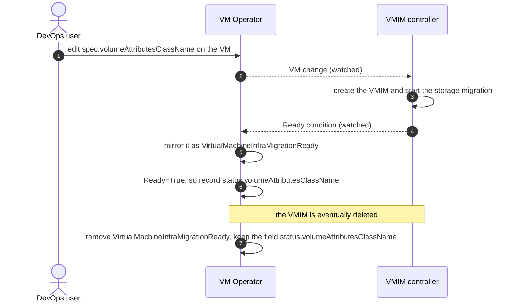

# Feature Specification: VirtualMachineInfraMigration Status on VirtualMachine

- **Feature branch**: `topic/brito-rafa/vmim-status-on-vm`
  - **PR target**: `vmware-tanzu/vm-operator`
- **Created**: 2026-10-30
- **Status**: Draft
- **Epic**: vmop-3432

---

## Summary

The mobility operator migrates a VirtualMachine to target infrastructure (a resource pool and/or storage policies for the VM home and its volumes) through a `VirtualMachineInfraMigration` resource. The migration resource has the same namespace and name as the VirtualMachine it migrates, and reports its overall outcome in a `Ready` condition on its own status.

A DevOps user looking at a VirtualMachine has no way to tell that such a migration has converged without also finding and reading the migration resource. This feature surfaces that outcome on the VirtualMachine itself: VM Operator mirrors the migration's `Ready` condition, when it describes the migration's current generation, onto the VirtualMachine's status as a `VirtualMachineInfraMigrationReady` condition, and, only when the migration is ready, records the VolumeAttributesClass the VirtualMachine is now configured to in a new `status.volumeAttributesClassName` field. The migration reports the storage policy of the VirtualMachine's home directory rather than a VolumeAttributesClass name, so the field is the VolumeAttributesClass on the cluster that refers to that policy, and it must also be the one named in the VirtualMachine's `spec.volumeAttributesClassName`.

A change to a VirtualMachine's `spec.volumeAttributesClassName` is turned into a `VirtualMachineInfraMigration` by the mobility operator, which watches the VirtualMachine objects, and the migration starts the storage migration right away. The migration could be short-lived and might be eventually deleted: the `VirtualMachineInfraMigrationReady` condition describes it while it exists and is removed when it is gone, while `status.volumeAttributesClassName`, which only VM Operator writes, is the durable record and is kept.

The migration also applies the encryption that its target storage policy requires, with the key VM Operator resolves, for the VM home and for each attached PVC that specifies `spec.volumeAttributesClassName`. A detached PVC has its own migration resource and is handled by CSI. So, for an existing VirtualMachine that specifies `spec.volumeAttributesClassName`, VM Operator no longer encrypts it, or writes a storage policy on its disks, because that storage policy is encrypted: the migration does both for the VM home and PVC-backed disks, and repeating them would duplicate its work and could race with it. A disk with no PVC, such as a fast-deploy disk, is not covered by the migration, so it is left as it is. VM Operator still encrypts for a vTPM, still takes whether the VirtualMachine is encrypted from the VolumeAttributesClass's storage policy, and re-keys the VM home and attached PVC disks to the key it resolves once the migration is complete, since a migration to another datastore keeps the current key.

The behavior is inert unless the `StoragePolicyMutability` capability is enabled for the Supervisor.

The `VirtualMachineInfraMigration` `v1alpha4` CRD is guaranteed to be installed when the `StoragePolicyMutability` capability is enabled.

---

## Goals

- When the capability is enabled, VM Operator MUST watch `VirtualMachineInfraMigration` resources.
- When a VirtualMachine with the same namespace and name as a `VirtualMachineInfraMigration` exists and is not being deleted, VM Operator MUST mirror the migration's `Ready` condition onto that VirtualMachine's status as the `VirtualMachineInfraMigrationReady` condition, whatever the condition's status (`True`, `False`, or `Unknown`), provided it describes the migration's current generation (the condition's `observedGeneration` has caught up to the migration's `metadata.generation`). The migration's other conditions (`Validated`, `StorageInSync`, `ComputeInSync`, and any the mobility operator adds) are not mirrored, so the VirtualMachine API does not depend on the mobility operator's condition vocabulary.
- The `VirtualMachineInfraMigrationReady` condition MUST be removed from the VirtualMachine when the migration stops reporting a `Ready` condition, or when its `Ready` condition no longer describes the migration's current generation, so that the VirtualMachine does not keep reporting an outcome of the migration's previous spec.
- Only when a `VirtualMachineInfraMigration` has a `Ready` condition with status `True` that describes its current generation (the `Ready` condition's `observedGeneration` has caught up to the migration's `metadata.generation`), and a VirtualMachine with the same namespace and name exists and is not being deleted, VM Operator MUST set the VirtualMachine's `status.volumeAttributesClassName` to the name of the VolumeAttributesClass whose storage policy ID (`parameters["storagePolicyID"]`) is the migration's `spec.targetStorage.homeStoragePolicyID`, provided that VolumeAttributesClass is also the one in the VirtualMachine's `spec.volumeAttributesClassName`. When several VolumeAttributesClasses refer to the same policy, the one in the VirtualMachine's spec decides.
- VM Operator MUST NOT write `status.volumeAttributesClassName` when the migration has no `spec.targetStorage.homeStoragePolicyID`, when no VolumeAttributesClass refers to that policy, or when the VirtualMachine's `spec.volumeAttributesClassName` is unset or is not one of the VolumeAttributesClasses that refer to it. The last two cases most likely mean that the spec was edited again and the mobility operator has not picked it up yet, so VM Operator MUST NOT treat them as an error: it MUST still mirror the `Ready` condition, and it writes nothing until the VirtualMachine's spec, the migration, or the VolumeAttributesClasses change.
- VM Operator does not pause the reconciliation of a VirtualMachine while a `VirtualMachineInfraMigration` for it exists and is not ready (for example its `Ready` condition is `False`), and does not add a validation that rejects a change to the VirtualMachine's `spec.volumeAttributesClassName` while the migration is running. Neither is needed: VM Operator already skips reconciling a VirtualMachine's spec while a task is running on it in vSphere (including DRS activity), which is enough to avoid concurrent operations on the VirtualMachine.
- The mirrored condition's status, reason, and message MUST be copied from the migration's `Ready` condition (from VMIM .status.conditions to VM .status.conditions) so that a user can read the outcome from the VirtualMachine alone. The mirrored message MUST be followed by a reference to the migration, in the form `<message> @ VirtualMachineInfraMigration/<name>`, so that a user can tell which resource the condition came from. A `Ready` condition without a message is mirrored with only the reference as its message. A `Ready` condition without a reason is mirrored with the status as its reason, because a condition's reason must not be empty. If the message followed by the reference would be longer than a condition message can be (32768 characters), the migration's message MUST be truncated so that the reference is always present. The migration condition's `observedGeneration` MUST NOT be copied, since it refers to the migration's generation rather than the VirtualMachine's.
- Mirroring MUST NOT overwrite or drop any condition on the VirtualMachine other than the mirrored `Ready` condition, including conditions written concurrently by the VirtualMachine controller.
- Re-reconciling a migration whose `Ready` condition is unchanged MUST NOT change the VirtualMachine (in particular, the mirrored condition's last transition time MUST NOT move).
- VM Operator SHOULD log at Info level only when the status of the mirrored condition changes (including it being added or removed) or `status.volumeAttributesClassName` is newly recorded, so that reconciling an unchanged migration, or one whose `Ready` condition only changed its reason or message, does not write to the log at the default verbosity.
- If the VirtualMachine is created after the migration's `Ready` condition was set, the condition MUST still be mirrored once the VirtualMachine exists.
- When the `VirtualMachineInfraMigration` is deleted, VM Operator MUST remove the `VirtualMachineInfraMigrationReady` condition from the VirtualMachine, because it would otherwise describe a resource that no longer exists, and this includes a migration that was deleted while VM Operator was not running. It MUST NOT clear `status.volumeAttributesClassName` in any case, because that field describes what the VirtualMachine is configured to, not the migration.
- When the capability is disabled, VM Operator MUST NOT start the controller and MUST NOT require the `VirtualMachineInfraMigration` API to be present.
- For an existing VirtualMachine that specifies `spec.volumeAttributesClassName`, and for the disk of an attached PVC that specifies it, VM Operator MUST NOT encrypt the VirtualMachine or the disk because the storage policy of the VolumeAttributesClass is encrypted, and MUST NOT write a storage policy on its disks, since the migration does both for the VM home and PVC-backed disks. A disk with no PVC is not covered by the migration, and is left as it is. It MUST still encrypt a VirtualMachine for a vTPM, as under a StorageClass. A VirtualMachine that is being created is not affected, and is encrypted from its storage policy as before.
- Whether a VirtualMachine or an attached PVC is encrypted MUST be taken from the storage policy of its VolumeAttributesClass when it specifies one, and otherwise from its StorageClass, so that a VirtualMachine the migration encrypted is not reported as invalid for lacking an encrypted StorageClass or a vTPM. `spec.crypto.encryptionClassName` MUST be validated against that storage policy. An error resolving the VolumeAttributesClass MUST be returned, not ignored.
- VM Operator MUST re-key an encrypted VM home, and the disk of an encrypted attached PVC, whose key differs from the one VM Operator resolves, and MUST NOT write a storage policy when it does. The key is resolved as without a VolumeAttributesClass: for the VM home, the EncryptionClass in `spec.crypto.encryptionClassName`, else the default key provider when `spec.crypto.useDefaultKeyProvider` is true; for a PVC, the EncryptionClass in its `csi.vsphere.encryption-class` annotation, else the default key provider. The VirtualMachine's EncryptionClass does not apply to its PVCs.
- VM Operator MUST NOT re-key the VM home or a PVC disk while its change to its VolumeAttributesClass is in progress, that is while the class it is observed to have (`status.volumeAttributesClassName` for the VirtualMachine, `status.currentVolumeAttributesClassName` for the PVC) is not empty and is not the one in its spec. An empty observed class counts as in sync, since nothing records one for an object that was created with a VolumeAttributesClass and never migrated, so the first migration of an object to a class is not held. Each object waits for its own change, and is re-keyed once its observed class is recorded.

## Non-goals

- Creating, updating, or deleting `VirtualMachineInfraMigration` resources. The mobility operator owns them.
- Updating the VirtualMachine's storage policy usage (quota) after a migration. The mobility operator's design lists it as a separate VM Operator step.
- Performing any migration or calling vSphere. This controller only reads the migration resource and writes VirtualMachine status.
- Surfacing the migration's other conditions (`Validated`, `StorageInSync`, `ComputeInSync`) or its other status (for example the observed resource pool) on the VirtualMachine.
- Updating `status.volumes[].conditions[]`. The migration has no per-volume status, so there is nothing to mirror.
- Patching the VirtualMachine's spec, including `spec.volumeAttributesClassName`.
- Any VirtualMachine API surface beyond the mirrored `Ready` condition and `status.volumeAttributesClassName`.
- Reporting `VirtualMachineEncryptionSynced` from the migration. While a re-key is held the condition is not touched and still reports from the crypto state. This is tracked by vmop-4465.
- Encrypting or re-keying a detached PVC. CSI does it, from the PVC's own migration resource.
- Encrypting a disk that has no PVC, such as a fast-deploy disk, for a VirtualMachine under a VolumeAttributesClass. The migration does not cover it either, and the mobility operator's design lists that as a limitation, so it is left as it is.
- Assigning the namespace's default EncryptionClass to a VirtualMachine created with an encrypted VolumeAttributesClass on a StorageClass that is not encrypted. The mobility operator's design applies the default class only to objects created on an encrypted StorageClass.
- Checks on a PVC's VolumeAttributesClass in the VirtualMachine webhooks.
- E2E coverage. It will be added after all the components are ready, and is tracked by vmop-4499.

---

## User stories and acceptance criteria

### DevOps user: seeing that a migration has converged

As a DevOps user, I want the VirtualMachine to tell me the state of its infrastructure migration, so that I do not have to look up a second resource.

1. Given a VirtualMachine `ns/vm` and a `VirtualMachineInfraMigration` `ns/vm` whose `Ready` condition is `True` for the migration's current generation, `kubectl get vm vm -o jsonpath='{.status.conditions[?(@.type=="VirtualMachineInfraMigrationReady")].status}'` returns `True`. If the `Ready` condition is `False` or `Unknown`, the same command returns `False` or `Unknown`.
2. The mirrored condition has the same status and reason as the migration's `Ready` condition, and its message followed by `@ VirtualMachineInfraMigration/<name>`. The migration's other conditions (for example `Validated`) are not mirrored, and the `observedGeneration` is not copied.
3. Given a migration whose `Ready` condition is `False`, `Unknown`, absent, or whose `observedGeneration` is less than the migration's `metadata.generation`, `status.volumeAttributesClassName` is not set by this feature.
4. Given a migration for a VirtualMachine that does not exist yet, creating the VirtualMachine results in the condition being mirrored without any further change to the migration.
5. All other conditions on the VirtualMachine are unchanged by the feature. When the migration stops reporting its `Ready` condition, the mirrored condition is removed from the VirtualMachine.
6. Given a ready migration whose `spec.targetStorage.homeStoragePolicyID` is the storage policy of VolumeAttributesClass `vac-a`, and a VirtualMachine whose `spec.volumeAttributesClassName` is `vac-a`, `kubectl get vm vm -o jsonpath='{.status.volumeAttributesClassName}'` returns `vac-a`.
7. Given a ready migration with a `homeStoragePolicyID`, but a VirtualMachine whose `spec.volumeAttributesClassName` is unset or refers to a different storage policy, or no VolumeAttributesClass for the policy, `status.volumeAttributesClassName` is not changed and the `VirtualMachineInfraMigrationReady` condition is still set.
8. Given a ready migration with no `homeStoragePolicyID`, `status.volumeAttributesClassName` is not changed.
9. Given the migration is then deleted, the VirtualMachine no longer has the `VirtualMachineInfraMigrationReady` condition, and `status.volumeAttributesClassName` keeps its value.
10. The mirrored condition is copied only when the `Ready` condition's `observedGeneration` has caught up to the migration's `metadata.generation`. When the migration's spec changes and its generation advances, the VirtualMachine's mirrored condition is removed until the migration reports `Ready` for the new generation. This avoids a stale condition, such as the VirtualMachine briefly reporting `True` for a migration that describes its previous spec.

### CSP admin: rollout safety

1. With the capability disabled, VM Operator starts and runs on a Supervisor that has no `VirtualMachineInfraMigration` CRD installed.
2. For a VirtualMachine or a PVC that does not specify a VolumeAttributesClass, encryption and re-keying are unchanged and follow the StorageClass. While the capability is disabled, a PVC's `spec.volumeAttributesClassName` is ignored.

### DevOps user: encryption under a VolumeAttributesClass

As a DevOps user, I want a VirtualMachine that specifies `spec.volumeAttributesClassName` to stay encrypted with the key I chose, without VM Operator repeating what the migration does.

1. Given an encrypted VirtualMachine with no vTPM, on a StorageClass that is not encrypted, whose `spec.volumeAttributesClassName` names a class with an encrypted storage policy, `kubectl get vm vm -o jsonpath='{.status.conditions[?(@.type=="VirtualMachineEncryptionSynced")].status}'` returns `True`, not `False` with the reason `InvalidState`.
2. Given an existing VirtualMachine with no vTPM that is not encrypted, with such a `spec.volumeAttributesClassName`, VM Operator does not encrypt it or write a storage policy on its disks. The same holds for an unencrypted disk of an attached PVC that specifies such a class.
3. Given the same VirtualMachine with a vTPM, or one that adds a vTPM, VM Operator encrypts it as it does under a StorageClass.
4. Given a new VirtualMachine created with such a `spec.volumeAttributesClassName`, it is encrypted at creation as before.
5. Given an encrypted VirtualMachine whose key differs from the one VM Operator resolves, for example after the migration moved it to another datastore and kept its key, or after the DevOps user changed `spec.crypto.encryptionClassName`, and whose `status.volumeAttributesClassName` is empty or the class in its spec, VM Operator re-keys it, and its disks, to the resolved key and writes no storage policy. The same holds for the disk of an encrypted attached PVC, from its `status.currentVolumeAttributesClassName`.
6. Given a `status.volumeAttributesClassName` that is another class than the one in the spec, VM Operator does not re-key the VirtualMachine until the migration completes and the class is recorded. The same holds for an attached PVC.
7. Given a `spec.crypto.encryptionClassName` and a `spec.volumeAttributesClassName` whose storage policy is not encrypted, the request is rejected with `requires spec.volumeAttributesClassName specify an encryption storage policy`. Without a `spec.volumeAttributesClassName`, the message for a StorageClass that is not encrypted is unchanged.

---
