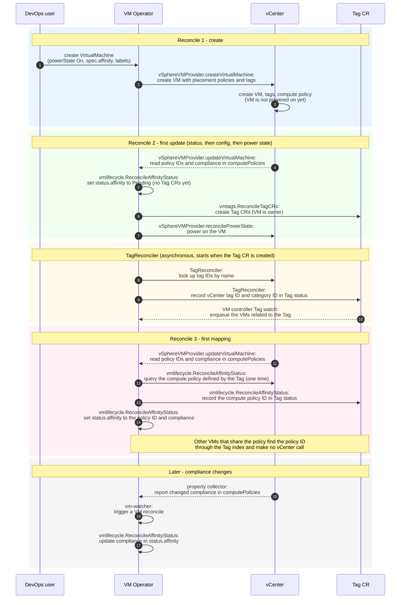

# Feature Specification: VirtualMachine Affinity Status (`status.affinity`)

- **Feature branch**: `aniketd/4283-affinity-status`
  - **PR target**: `vmware-tanzu/vm-operator`
- **Created**: 2026-11-24
- **Status**: Draft
- **Epic**: vmop-4283
- **Depends on**: [`006-tag-controller-for-affinity`](../006-tag-controller-for-affinity/) (the `Tag` API, hashed tag identities, and `ReconcileTagCRs`, landed in d58b9f964)

---

## Summary

A DevOps user expresses placement intent through `spec.affinity` on a `VirtualMachine`. VM Operator turns that intent into vCenter Tags and `VmPlacementPolicies` on the VM's reconfigure request, and `vpxd` creates and evaluates the resulting vCenter compute policies. Today, the user has no way to tell from the Supervisor whether vCenter considers the VM compliant with those policies. The only way to find out is to inspect vCenter directly.

This feature adds `status.affinity` to `VirtualMachine`. It reports every VM Operator affinity policy that vCenter associates with the VM, together with the policy's identity in Kubernetes terms (type, strictness, topology key, and target labels), the vCenter compute policy ID, and the most recent compliance state that vCenter recorded. The status is driven by VM state, meaning what vCenter reports for this VM. It therefore covers both VMs that request a policy through their own `spec.affinity` and label-only VMs that a policy applies to because they carry its tag.

The problem is mapping. vCenter reports policy compliance through the VM's `computePolicies` property, which is delivered to VM Operator by the property collector. That property carries only a **policy ID** and a **compliance status**. VM Operator never creates compute policies itself (`vpxd` does, from the `VmPlacementPolicies` in the reconfigure), so it holds no record of which policy ID corresponds to which affinity rule.

The feature closes that gap in three steps, using the `Tag` resource from spec 006 as the durable cache:

1. **Tag name → vCenter tag ID.** The `Tag` controller resolves each `Tag`'s backend name (in the namespace's tag category) to the vCenter tag UUID and category UUID, using the vSphere tagging list APIs (`tagging.category.ls` and `tagging.tag.ls`) with name filters. It records both in `Tag.status`. This happens once, on the first reconcile after the vCenter tag exists.
2. **Policy ID → `Tag` (one-time reverse lookup).** Policy tags are hashed (spec 006), so each policy-defining `Tag` maps to exactly one vCenter policy. When a VM is related to a policy `Tag` that has `status.id` but no `status.policyID` yet, and the VM's `computePolicies` lists an ID that no `Tag` claims, VM Operator calls the VM compute-policy query API, filtered to that VM and to those unclaimed IDs. The result includes each policy's defining tag UUID. VM Operator matches it to `Tag.status.id` and records the policy ID in `Tag.status.policyID`. After that, every VM that shares the policy, on every reconcile, finds the mapping with a cached lookup and never calls vCenter.
3. **Policy ID + compliance → `status.affinity`.** On each reconcile, VM Operator looks up the `Tag` for every policy ID in the VM's `computePolicies`, using a field index on `Tag.status.policyID`. It builds one status entry per match from the `Tag`'s immutable `spec.policy`. Hashes cannot be decoded, but the `Tag` already holds the canonical policy inputs.

The behavior is gated by the existing `VMHardAffinityDuringExecution` Supervisor capability, which already turns on `Features.TaggingAPI` and `Features.VMHardAffinityDuringExecution`. No new feature flag is introduced.

---

## Goals

- **G1**: For every policy ID in the VM's `computePolicies` that maps to a policy-defining `Tag` in the VM's namespace, `status.affinity.policies` **MUST** contain exactly one entry. The entry describes the policy in Kubernetes terms, taken from the `Tag`'s `spec.policy`: type, strictness, topology key, and the sorted target label pairs. It also carries the policy ID and the compliance that vCenter most recently recorded for this VM.
- **G2**: Entries **MUST** be produced both for VMs that request the policy through their own `spec.affinity` and for label-only VMs that vCenter associates with the policy because they carry its tag.
- **G2a**: Each entry **MUST** report its `origin`: `Self` when the VM's own `spec.affinity` requests the policy, and `Peer` when another VM's `spec.affinity` requests it and the policy applies to this VM because it carries the policy's target labels.
- **G3**: For a policy-defining `Tag` that the VM owns or carries but whose policy ID is not yet mapped, `status.affinity` **MUST** contain an entry with `compliance: Pending` and no policy ID.
- **G4**: Compliance changes that vCenter reports through `computePolicies` **MUST** be reflected in `status.affinity` without any vCenter API call. The property collector (vm-watcher) triggers the reconcile, and the mapping comes from `Tag.status.policyID` through a cached index lookup.
- **G5**: The `Tag` controller **MUST** record the vCenter tag UUID (`status.id`) and tag category UUID (`status.categoryID`) of every `Tag` once the vCenter tag exists, looking them up by name and never by listing every tag in vCenter. While the vCenter tag does not exist yet, the controller **MUST** retry with exponential backoff (5s, rising to 5m) and report that state in a condition.
- **G6**: The compute-policy query **MUST** run only while some policy-defining `Tag` related to the VM has `status.id` set and `status.policyID` empty, **and** the VM reports at least one policy ID that no `Tag` claims. Once a `Tag` records `status.policyID`, VMs **MUST NOT** query vCenter for it again.
- **G7**: In steady state (every related policy `Tag` mapped), a VM reconcile **MUST NOT** make any vCenter REST call for this feature, regardless of how many unrelated policies (for example from the vSphere Policy reconciler) the VM carries.
- **G8**: Policy IDs in `computePolicies` that map to no `Tag` **MUST NOT** appear in `status.affinity`.
- **G9**: When the VM no longer reports any VM Operator affinity policy and owns or carries no policy-defining `Tag`, `status.affinity` **MUST** be removed.
- **G10**: With the capability off (`TaggingAPI` or `VMHardAffinityDuringExecution` false), VM Operator **MUST** behave exactly as it does today. It **MUST NOT** request the `computePolicies` property, make any new vCenter call, or write `status.affinity` or the new `Tag.status` fields. Any `status.affinity` that was written earlier **MUST** be cleared.
- **G11**: DevOps users **MUST NOT** be able to write the new `Tag.status` fields. The status subresource is already restricted by spec 006's RBAC and admission.

## Non-goals

- **NG1**: Changing how compute policies or tags are generated (spec 006 NG5).
- **NG2**: Status for the legacy (non-hashed) affinity path. Without hashed tags, several policies can share one tag, so the one-tag-to-one-policy mapping does not hold.
- **NG3**: Status for transient placement-time policies (`isPlacement`, which target original tags).
- **NG4**: Triggering compliance evaluation. VM Operator only reads stored status.
- **NG5**: Repairing out-of-band changes in vCenter, such as a tag deleted and recreated with a new UUID, or a policy deleted or recreated by an administrator. Stale `Tag.status` IDs are not detected or refreshed.
- **NG6**: An aggregate condition (such as `VirtualMachineAffinityCompliant`). Status per policy is the complete surface.
- **NG7**: Surfacing a VM Operator condition for failed tagging or policy-query calls. Failures are logged only.
- **NG8**: Affinity status on `VirtualMachineGroup` or `VirtualMachineReplicaSet`.
- **NG9**: vcsim support for `computePolicies` and the compute-policy query API. Tests use fakes (see `plan.md`).
- **NG10**: Multi-vCenter (as in spec 006 NG2).

---

## Key entities

### Policy-defining `Tag`s

| `Tag` kind | vCenter policy | Tag's role in the policy |
|------------|----------------|--------------------------|
| `AffinityTarget` | `VmVmAffinity` | `AffinedVmsTag`, carried by every VM with the source label |
| `GroupedAntiAffinitySelf` | `VmToVmGroupsAntiAffinity` | `SelfTag`, carried by the requesting VMs |

The compute-policy query returns the policy's single defining tag: `AffinedVmsTag` for `VmVmAffinity`, and the `SelfTag` for `VmToVmGroupsAntiAffinity`. The query does not return the anti-affined group tags, and they are not needed to report status. `Original` and `GroupedAntiAffinityTarget` `Tag`s never get a `status.policyID`.

### Related `Tag`s of a VM

A VM is related to a policy-defining `Tag` if it **owns** it (its `spec.affinity` requests the policy, so vCenter associates the policy through the VM's `VmPlacementPolicies`) or **carries** it (it has the source label of an `AffinityTarget` `Tag`, or is a requester of a `GroupedAntiAffinitySelf` `Tag`). Spec 006 already computes this set during tag reconciliation, so only related `Tag`s can trigger the reverse lookup (G6), and only they produce `Pending` entries (G3).

### `VirtualMachine.status.affinity`

A new, optional status block that only VM Operator writes. It holds a list of entries, one per policy, each built from a `Tag`'s `spec.policy` plus the compliance reported for the VM. A `spec.affinity` term can resolve to several label pairs, and each strictness list and topology produces separate policies, so entries map to **policies**, not to terms.

### `Tag.status` (extended)

- `id` — the vCenter tag UUID.
- `categoryID` — the vCenter tag category UUID of the namespace's category.
- `policyID` — for policy-defining kinds only, the ID of the single vCenter compute policy this tag defines.

### `computePolicies` (vCenter VM property, vSphere 9.1+)

`[]VirtualMachineComputePolicyInfo{policyId, complianceStatus}`. VM Operator watches it through vm-watcher and reads it on every VM update.

### VM compute-policy query API

`POST /api/vcenter/vm/compute/policies?action=query`. Given VM IDs and a policy-ID filter, it returns each policy's ID, defining tag UUID, and compliance.

---

## User stories and acceptance criteria

### US1 — DevOps user: see whether my affinity rules are satisfied (P1)

As a DevOps user, I want to read from my `VirtualMachine` whether vCenter considers each affinity and anti-affinity policy that applies to it satisfied, so I can tell an unsatisfied placement apart from a working one without vCenter access.

1. **Given** a VM declares one `requiredDuringSchedulingPreferredDuringExecution` anti-affinity term at host topology against `app=db`, **when** vCenter creates the policy and reports the VM `Compliant` in `computePolicies`, **then** `status.affinity.policies` has exactly one entry with `type: AntiAffinity`, `strictness: RequiredDuringSchedulingPreferredDuringExecution`, `topologyKey: kubernetes.io/hostname`, `targets: [{key: app, value: db}]`, a non-empty `policyID`, `compliance: Compliant`, and `origin: Self`.
2. **Given** scenario 1, **when** vCenter later records `NonCompliant` for that policy on the VM, **then** the property collector triggers a reconcile and the entry's `compliance` becomes `NotCompliant`, with no vCenter REST call made.
3. **Given** VM A declares an affinity term against `tier=web`, and VM B carries `tier=web` with no `spec.affinity`, **when** vCenter associates the `VmVmAffinity` policy with both, **then** both A and B report the same `Affinity` entry (same `policyID`), each with its own compliance. A reports `origin: Self` and B reports `origin: Peer`.
4. **Given** a related policy `Tag` whose `status.policyID` is not yet set, **then** the VM reports that policy as `compliance: Pending` with no `policyID`, and the entry is completed without user action once the mapping resolves.
5. **Given** a VM with an affinity term at both host and zone topology, or in both strictness lists, **then** each resulting policy gets its own entry.
6. **Given** the VM's affinity is removed and it no longer carries any policy tag, **then** `status.affinity` is removed after vCenter disassociates the policies.
7. **Given** the VM also has a compute policy that does not come from VM Operator affinity (for example, one from a vSphere Policy `ComputePolicy`), **then** that policy does not appear in `status.affinity`, and its presence never causes a compute-policy query once the VM's related `Tag`s are mapped.
8. **Given** VMs W1 and W2 declare a host anti-affinity term against `app=database`, and VM D carries `app=database` with no `spec.affinity`, **when** vCenter associates the `VmToVmGroupsAntiAffinity` policy with D as a member of the anti-affined group, **then** D reports the `AntiAffinity` entry with `origin: Peer`, and W1 and W2 report it with `origin: Self`.

### US2 — Platform engineer / CSP admin: diagnose the tag and policy mapping (P2)

As a platform engineer, I want each `Tag` to record its vCenter tag, category, and policy identifiers, so I can correlate a Supervisor `Tag` with vCenter objects and see why a VM's affinity status is `Pending`.

1. **Given** a `Tag` is created and vpxd has created the corresponding vCenter tag, **then** within one `Tag` reconcile, `status.id` and `status.categoryID` hold the vCenter UUIDs and `VCenterTagResolved` is `True`.
2. **Given** a `Tag` whose vCenter tag does not exist yet, **then** `VCenterTagResolved` is `False` with reason `NotFound`, and the controller retries with backoff from 5s up to 5m until the tag appears.
3. **Given** two VMs that relate to the same policy, **when** the first VM resolves the mapping, **then** the `Tag`'s `status.policyID` is set, and the second VM reports compliance without calling the query API.
4. **Given** `status.id` is already set, **then** the `Tag` controller makes no tagging API call.
5. **Given** an `Original` or `GroupedAntiAffinityTarget` `Tag`, **then** `status.policyID` is never set.

### US3 — CSP admin: rollout safety and vCenter load (P1)

As a CSP admin, I want this feature to be inert unless the capability is enabled, and cheap when it is.

1. **Given** the `VMHardAffinityDuringExecution` capability is off, **then** vm-watcher does not watch `computePolicies`, `updateVirtualMachine` does not fetch it, no tagging or compute-policy REST call is made, and neither `status.affinity` nor the new `Tag.status` fields are written.
2. **Given** the capability is turned off after `status.affinity` was written, **then** the next VM reconcile clears it.
3. **Given** every related policy `Tag` of a VM is mapped, **then** reconciling that VM makes zero tagging or compute-policy REST calls.
4. **Given** a related policy `Tag` is unmapped and the compute-policy query returns no policy defined by it, **then** the VM reconcile is not an error: the entry stays `Pending`. When async signal is off the VM is requeued after a delay; when it is on the property collector wakes the VM.
5. **Given** a compute-policy query or tagging call fails, **then** the VM reconcile does not fail. Affected entries keep their previous `policyID` with the compliance that vCenter currently reports for it, or report `Pending` when the policy is no longer reported. The error is logged, and the VM is requeued after a delay, without an error, to retry.

---

## Edge cases

- **vCenter tag not created yet.** The `Tag` is created before the reconfigure that makes vpxd create the vCenter tag. The `Tag` controller retries with backoff, and the VM's entry stays `Pending`. When `status.id` is set, the `Tag`'s owner VMs and the VMs carrying it are re-enqueued.
- **Policy not associated yet.** The related `Tag` is unmapped and the VM reports no unclaimed ID, so no query is made and the entry is `Pending`. When vCenter associates the policy, the property collector triggers the reconcile that performs the lookup.
- **Related `Tag` unmapped while only unrelated policies are reported.** vCenter has not associated the policy with the VM yet, so the query runs and matches nothing. This is not an error. The entry stays `Pending`. With async signal on, the property collector wakes the VM when vCenter associates the policy, and the `Tag` watch wakes it when a peer VM maps the `Tag`, whichever comes first. With async signal off, the VM is requeued after 30s with no error, so the error rate limiter is not involved. See `plan.md` "Query trigger".
- **Anti-affinity peer reconciled before the policy ID is recorded.** A peer VM that carries a target label of a grouped anti-affinity policy is not related to the policy's `GroupedAntiAffinitySelf` `Tag`, so it cannot record the `Tag`'s `status.policyID`. If vCenter reports the policy for the peer before a requesting VM records the ID, the peer has no entry for it. When the ID is recorded, the `Tag` watch enqueues the `Tag`'s owners and the VMs carrying any of its target labels, so the peer then reports the entry with `origin: Peer`.
- **Transient error.** A failed compute-policy query, `Tag` patch, or `Tag` read keeps the previous entries as described in US3 scenario 5. No watch event is guaranteed to follow, so the VM is requeued after 30s with no error, with async signal on or off.
- **Concurrent writers of `Tag.status.policyID`.** Several VMs that share a policy can resolve it at the same time. Each writer computes the same value, patches with an optimistic lock, and skips the write when the value is unchanged.
- **`Tag` deleted and recreated.** The new `Tag` starts with empty status and resolves again.
- **Out-of-band vCenter changes** (tag or policy recreated with a new ID): out of scope (NG5). Affected entries may stay `Pending` or disappear.
- **VM paused, or with an outstanding task.** Status reconcile runs as it does today.

---

## Open questions

None. The resolutions are recorded in `research.md` R6.
